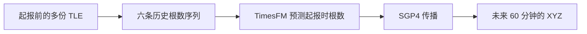

# 3 分钟认识 TLE、轨道根数和 SGP4

先记住各自分工：**TLE 提供轨道参数，TimesFM 预测参数的变化，SGP4 根据参数计算位置和速度。**

## 1. TLE 是什么？

TLE 是 **Two-Line Element**，通常称为“双行轨道根数”。它用两行固定格式的文本，记录目标编号、参考时刻和一组轨道参数等信息。下面就是仓库 [data/debris.tle](data/debris.tle) 中的第一份数据：

```text
0 COSMOS 2251 DEB
1 33757U 93036E   13280.83870529  .00000016  00000-0  15813-4 0  8147
2 33757 074.0368 158.4393 0014763 178.4881 257.2793 14.31753325243161
```

开头的 `0 COSMOS 2251 DEB` 是附加名称；以 `1`、`2` 开头的才是 TLE 的两行。格式按固定列读取，数字紧挨在一起时也有明确边界。[格式说明](https://celestrak.org/NORAD/documentation/tle-fmt.php)

先认识两个字段：

- `33757`：这个空间目标的 NORAD 编号。
- `13280.83870529`：**历元**，这里表示 2013 年第 280 天的小数时刻，即约 **2013-10-07 20:07:44 UTC**。

历元是参数对应的参考时刻。下载到一份 TLE 的时间、它的发布时间和历元可以不同；本仓库另外假设“历元后 24 h 可用”，这是实验约定。

## 2. 六个轨道根数描述什么？

可以把轨道想成空间里一条倾斜的椭圆：要描述它多大、多扁、朝哪里，还要描述物体沿轨道走到哪一步。该 TLE 第二行包含的六个参数是：

| 参数 | 本例数值 | 直观含义 |
|---|---:|---|
| 倾角 i | 74.0368° | 轨道平面相对赤道面的倾斜程度 |
| 升交点赤经 Ω | 158.4393° | 轨道平面在空间中的朝向 |
| 偏心率 e | 0.0014763 | 椭圆有多扁，接近 0 表示接近圆形 |
| 近地点幅角 ω | 178.4881° | 椭圆在轨道平面内的朝向 |
| 平近点角 M | 257.2793° | 描述沿轨道运动进度的相位参数 |
| 平均运动 n | 14.31753325 圈/天 | 每天绕行多少圈，与轨道大小相关 |

`0014763` 的小数点省略了，因此 e = 0.0014763。用 `1440 / n` 可估算本例每圈约 **100.6 分钟**；程序里的角度会转换成弧度。[字段与单位](https://celestrak.org/NORAD/documentation/tle-fmt.php)

这些是配合 SGP4 使用的**平均根数**。理解为描述轨道的参数即可；它们不是直接记录的 XYZ 位置，也不能当成任意时刻的瞬时二体根数直接使用。[TLE 常见问题](https://celestrak.org/columns/v04n03/)

## 3. SGP4 是什么？

SGP4 的全名是 **Simplified General Perturbations 4**，是一种轨道传播模型。“传播”就是：给定轨道参数，计算指定时刻的位置和速度。

```text
输入：一份 TLE ＋ 想计算的时间
                    ↓
                  SGP4
                    ↓
输出：位置 X、Y、Z ＋ 速度 Vx、Vy、Vz
```

它近似考虑地球非球形引力、大气阻力等影响。本 Demo 使用的库输出 TEME 坐标系下的 km、km/s，程序再转换为 m、m/s；XYZ 是空间直角坐标，不是地面经纬度。[SGP4 文档](https://pypi.org/project/sgp4/2.27/)

SGP4 根据已有参数进行计算；新的 TLE 需要另外获取。随着轨道变化和参数误差积累，已有参数传播出的轨道可能逐渐偏离实际轨道。

## 4. 为什么还需要 TimesFM？

多份历史 TLE 组成六条根数时间序列。这里让原始 TimesFM 根据这些序列，推算**起报时刻的根数**，然后仍由 SGP4 计算未来轨道。这样可以检验：先预测参数，是否比直接使用最新已知 TLE 更好。



原始 TimesFM 已经过预训练，本 Demo 只调用它推断，不针对这个碎片训练或微调。程序将预测根数直接交给 SGP4 初始化接口，无需先输出新的两行文本文件。

## 5. 用“今天 10 点起报”理解三种方法

用一个简化例子：**今天 10:00 起报，最新已知 TLE 的历元是昨天 10:00**。这符合本 Demo 的 24 h 可用时间假设。

| 方法 | 怎样计算今天 10:01～11:00 的轨道？ |
|---|---|
| 最新 TLE＋SGP4 | 用昨天 10:00 那份根数，直接经 SGP4 传播到目标时间 |
| 根数线性外推＋SGP4 | 根据历史根数的变化趋势，外推今天 10:00 的根数，再用 SGP4 传播 |
| TimesFM 根数预测＋SGP4 | 用 TimesFM 推算今天 10:00 的根数，再用 SGP4 传播 |

因此，“预测未来一小时轨道”还包含一步：根数方案要先跨越最新 TLE 历元到起报时刻约 24 小时的间隔。三种方法使用同一组未来时间评分。

后来取得的 TLE 只用于事后比较。图中相对它的三维偏差越小，说明预报越接近这份参考轨道；它仍不是独立的实测真值。

接下来：[运行 Demo](README.md#1-下载与运行) · [读懂六根数预测代码](ELEMENTS_EXPERIMENT.md) · [数据与评价约定](DATA_SOURCES.md)
