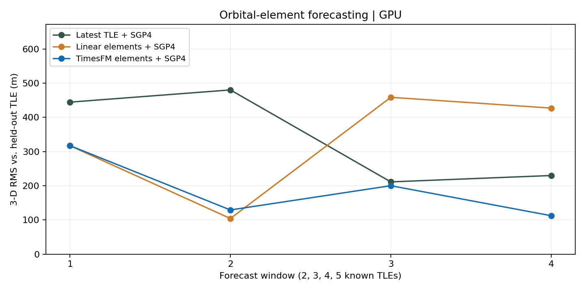

# 预测轨道根数的小实验

第一次接触 TLE、历元或 SGP4？先读 [3 分钟基础知识](BASICS.md)，再看下面的预测步骤。

**本次结果更好：TimesFM 根数预报的合并 RMS 为 206.15 m，最新已知 TLE 的 SGP4 为 362.45 m。** 这里评价的是与留后 TLE 的接近程度。

## 1. 这次预测什么？

预测路线：`已知 TLE 的六个平均根数 → TimesFM → 起报时的六根数 → SGP4 预报一小时`。

| TLE 参数 | 直观含义 | 程序单位 |
|---|---|---|
| 平均运动 n | 每天绕行多少圈，决定轨道大小；代替半长轴 a | 圈/天 |
| 偏心率 e | 轨道有多扁 | 无量纲 |
| 倾角 i | 轨道平面的倾斜程度 | 弧度 |
| 升交点赤经 Ω | 轨道平面的朝向 | 弧度 |
| 近地点幅角 ω | 轨道椭圆在平面内的朝向 | 弧度 |
| 平近点角 M | 物体在轨道上的相位 | 弧度 |

使用 **SGP4 配套的 TLE 平均根数**，不把 XYZ 转成瞬时二体根数后直接塞进 SGP4。B* 保留最新已知 TLE 的值。模型仍是原始 TimesFM 3，没有微调。

## 2. 本科生可以按这五步读代码

核心 [elements.py](elements.py) 约 90 行，批量运行在 [compare_elements.py](compare_elements.py)，画图在 [plotting.py](plotting.py)。

1. **筛选历史。** 只读起报前已可用的 TLE，四个窗口分别有 2、3、4、5 份。沿用“历元后 24 h 可用”的回放假设。
2. **处理角度。** Ω、ω 展开 360° 跳变；M 每天转十多圈，先减去最新 n 对应的快速相位，再展开剩余慢变化。否则两天间转过的圈数会丢失。
3. **变成等间隔序列。** 在已知 TLE 历元之间作 1 小时间隔插值，每个根数减末值、按历史标准差缩放。四窗分别得到 55、168、224、272 点，信息仍仅来自 2～5 份 TLE。
4. **预测起报时根数。** 起报时距最新 TLE 历元约 24 h，所以先预测 25 个小时格点，再插值得到准确起报时刻的根数。恢复相位、尺度与角度范围，构造该起报历元的 SGP4 轨道。
5. **传播和评分。** SGP4 生成 +1 至 +60 分钟 XYZ；所有预测完成后才使用未来 TLE 参考计算三维 RMS。

线性对照使用相同的已知根数、相位处理和 SGP4，但在真实 TLE 节点上拟合斜率，并锚定最后一份 TLE 作外推。这样可以检查改善是否只是线性趋势的效果。

每个窗口采用全部可用历史，未按未来评分选择输入长度、角度处理方法或窗口。图中的过去 6 小时轨迹仅供显示，实际预测输入是已知 TLE 根数的小时序列。

## 3. 四个窗口都展示

下表是 **CPU 整段三维 RMS，单位 m**。合并值按四窗全部 240 个未来位置点计算，不是四个 RMS 的算术平均。

| 窗口 | 最新 SGP4 | 根数线性外推 | TimesFM 根数 |
|---|---:|---:|---:|
| 1 | 444.38 | 317.06 | 317.21 |
| 2 | 480.08 | 104.23 | 129.09 |
| 3 | 211.35 | 458.52 | 200.12 |
| 4 | 229.93 | 427.02 | 112.51 |
| **合并** | **362.45** | **354.96** | **206.15** |

TimesFM 根数预报相对最新 SGP4 降低 **43.12%**，相对根数线性外推降低 **41.92%**。对最新 SGP4 是 4/4 窗口改善，对根数线性外推是 2/4 窗口改善。



**整段改善不等于末端一定改善。** 第 60 分钟三维误差如下：

| 窗口 | 最新 SGP4（m） | TimesFM 根数（m） |
|---|---:|---:|
| 1 | 270.30 | 206.02 |
| 2 | 331.00 | 85.83 |
| 3 | 44.04 | 257.69 |
| 4 | 57.29 | 184.47 |

CPU/GPU 根数方案的合并 RMS 分别为 **206.150 / 206.176 m**，结论一致；两设备逐点位置的最大距离差约 **0.252 m**。

## 4. 自己运行和核对

按 README 安装 CPU 或 GPU 环境后：

```bash
python compare_elements.py --device cpu
python compare_elements.py --device gpu
python -m unittest discover -v
```

可用 `--checkpoint 本地模型目录` 避免重新下载。模型版本固定；测试不需要下载或加载 TimesFM。

新结果位于 `outputs/elements-cpu/` 或 `outputs/elements-gpu/`；实测归档位于 [reference/elements](reference/elements)。

每窗额外保存：

- `element_tle_knots.csv`：真正输入的 TLE 根数，时间以最新 TLE 历元为零。
- `element_input.csv`：展开角度、去 M 快相位后的小时序列；实际送入模型前还会减末值并缩放。
- `element_forecast.csv`：恢复尺度后的小时预测，M 仍为去快相位后的残余；第 0 行是已知末值。
- `elements.json`：已用 TLE、外推时长、预测根数及单位说明。
- `prediction.csv`、`metrics.csv`：逐点 XYZ、三维偏差、整段 RMS 和末端误差。

测试检查 SGP4 重建后的轨道一致性、多圈相位恢复、未来 TLE 隔离，并从归档 XYZ 重新核算指标和从预测根数重建轨道。

**这个小样本中，TimesFM 根数方案的合并 RMS 低于最新 TLE 的 SGP4 和根数线性外推，值得扩大实验。** 目前只有一个目标、6 份 TLE、4 个相关窗口；小时插值没有增加独立观测，后续 TLE 也不是独立精密真值，不能据此声称普遍达到 206 m 的真实轨道精度。

SGP4 参数及历元接口见 [sgp4 2.27 官方说明](https://pypi.org/project/sgp4/2.27/)；数据来源与时间假设见 [DATA_SOURCES.md](DATA_SOURCES.md)。
