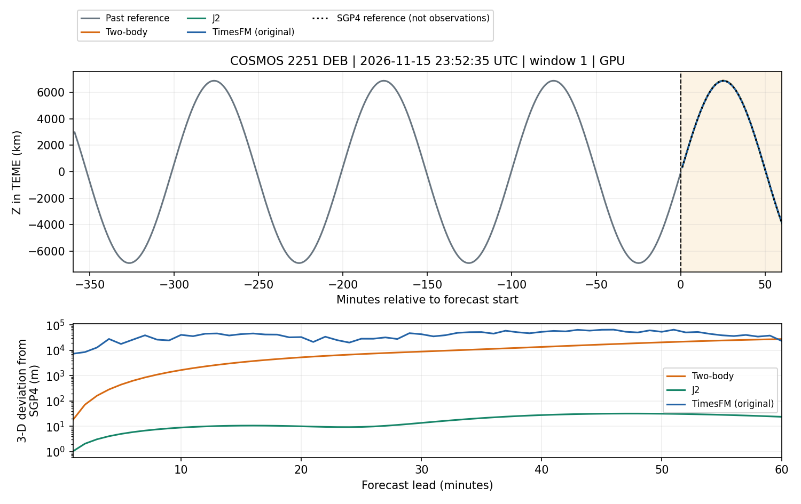
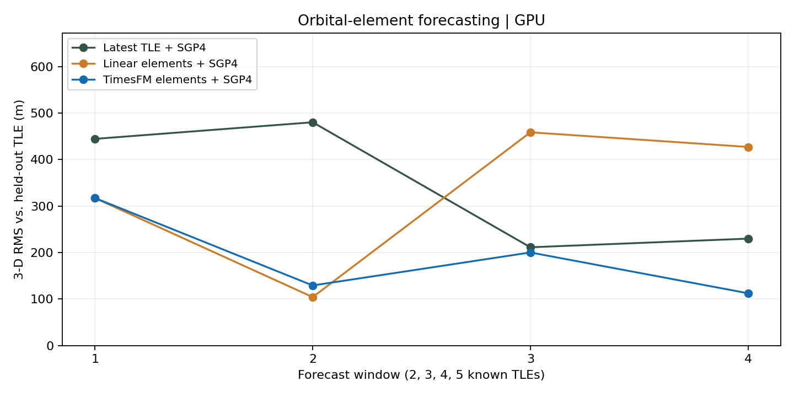

# 空间碎片轨道预测 Demo

以 **COSMOS 2251 DEB（NORAD 33757）** 的真实 TLE 为例：

**过去 6 小时参考轨迹 → 起报虚线 → 未来 60 分钟预测**

比较 **原始 TimesFM、二体模型、J2 模型**，保留 CPU/GPU 两种运行方式。数据、4 个固定窗口及全部预测结果已经附带。

**本例的过去和未来参考轨迹都由同一 TLE 经 SGP4 生成，不是实测轨道。** 它用于学习轨道传播与时间序列预测，误差表示“相对 SGP4 的偏差”，不能据此声称真实碎片轨道预测达到多少米精度。

## 1. 下载与运行

安装 Python **3.11 或 3.12** 和 Git：

```bash
git clone https://github.com/Xsleet/space-debris-orbit-demo.git
cd space-debris-orbit-demo
python -m venv .venv
```

激活环境：Windows 命令提示符执行 `.venv\Scripts\activate.bat`；Linux/macOS 执行 `source .venv/bin/activate`。PowerShell 可直接将下文 `python` 换成 `.\.venv\Scripts\python.exe`。

**选项 A：CPU**

```bash
python -m pip install torch==2.8.0 --index-url https://download.pytorch.org/whl/cpu
python -m pip install -r requirements-timesfm.txt
python main.py --device cpu
```

**选项 B：GPU，需要 NVIDIA 显卡和支持 CUDA 12.8 的驱动**

```bash
python -m pip install torch==2.8.0 --index-url https://download.pytorch.org/whl/cu128
python -m pip install -r requirements-timesfm.txt
python main.py --device gpu
```

CPU/GPU 只改变 TimesFM 推理设备，二体/J2 始终在 CPU 计算。首次自动下载约 **1.32 GB** 官方权重，**没有微调或训练步骤**。macOS 的 CPU 安装将第一条命令换为 `python -m pip install torch==2.8.0`。[PyTorch 官方安装说明](https://pytorch.org/get-started/previous-versions/#v280)。

只需快速体验、不想先下载大模型：

```bash
python -m pip install -r requirements.txt
python main.py --model physics
```

这会只运行二体/J2 对比。正常运行使用附带 CSV，不需要实时连接轨道数据网站，无需服务器。

## 2. 看懂结果

打开 `outputs/timesfm-cpu/window-01/result.png`；GPU 对应 `timesfm-gpu`。



上图用 Z 坐标表现“历史 → 起报 → 预测”；灰线为过去的 SGP4 参考轨迹，黑色点线为未来参考。下图用全部 XYZ 计算与 SGP4 的三维偏差，纵轴为对数。

| 方法 | 学生需要理解的内容 |
|---|---|
| SGP4 参考 | 把 TLE 平均轨道根数传播成位置和速度，生成本例的参考序列 |
| TimesFM | 读取过去 360 个 XYZ 位置，三个坐标分别预测；原始预训练模型，未微调 |
| 二体 | 从起报点的位置、速度出发，仅考虑地球中心引力 |
| J2 | 在中心引力上加上地球扁率的主要影响 |

位置为 m，速度为 m/s，间隔 60 s，坐标系为 **TEME**。物理基线使用起报点由 SGP4 计算的瞬时位置和速度；**不能把 TLE 平均根数直接当作瞬时二体根数**。TimesFM 只读历史位置，因此这不是相同输入特征的模型排名。

默认窗口在 TLE 历元之后 **6 小时**起报，约为 **2026-11-15 23:52:35 UTC**。未来 60 个点相对 SGP4 的三维 RMS 偏差，单位 m：

| 模型 | CPU | GPU |
|---|---:|---:|
| 二体 | 13,674.818 | 13,674.818 |
| J2 | **20.379** | **20.379** |
| TimesFM（未微调） | 43,195.733 | 43,195.912 |

J2 与 SGP4 在本窗口接近，**20.379 m 不是相对实测真值的误差**。TimesFM 的偏差更大，保留这个现象供分析。

`prediction.csv` 包含未来参考 XYZ、各模型预测 XYZ 和逐点三维偏差；`metrics.csv` 包含 RMS 与第 60 分钟偏差；`run.json` 记录窗口、坐标系及模型版本。

```text
每个点的三维偏差 = sqrt(dx² + dy² + dz²)
RMS(3D) = sqrt(所有未来点的三维偏差平方的平均值)
```

## 3. 换窗口，自主分析

窗口 1–4 在 TLE 历元后 **6、12、18、24 小时**起报。每次用过去 360 点（-359 至 0 分钟），预测 +1 至 +60 分钟，不按误差筛选。

```bash
python main.py --device cpu --window 3
python compare_windows.py --device cpu
python compare_windows.py --device gpu
```

批处理只加载一次模型，保存 `by_window.csv`、`summary.csv`、`comparison.png` 及各窗口完整结果；也支持 `--model physics`。



全部 **4 个窗口、240 个未来点**合并后的三维 RMS 偏差（m）：

| 模型 | CPU | GPU |
|---|---:|---:|
| 二体 | 28,662.293 | 28,662.293 |
| J2 | **58.709** | **58.709** |
| TimesFM（未微调） | 40,024.917 | 40,024.599 |

所有窗口都来自同一对象、同一 TLE，不能看作多个独立目标或真实测轨验证。直接预测 XYZ 的 TimesFM 缺少动力学约束，本例的总体偏差明显大于 J2。

可以讨论：为什么轨迹曲线重合仍可能相差几千米？为什么接近 SGP4 不等于接近真实轨道？若要研究真实预报精度，还需要什么独立观测或精密轨道？

## 4. 数据与复现

先读 [main.py](main.py) 理解实验流程，再读约 50 行的 [orbit.py](orbit.py) 理解动力学。[DATA_SOURCES.md](DATA_SOURCES.md) 说明真实 TLE 来源、时间、坐标和限制。

- TLE 快照已固定，历元为 **2026-11-15 17:52:35.014079 UTC**，取自 CelesTrak。
- `data/orbit.csv` 包含历元至 +25 h 的 1,501 个 SGP4 状态，正常运行无需重新生成。
- 执行 `python advanced/prepare_data.py` 可从附带 TLE 重建参考 CSV；不会下载或悄悄替换 TLE。
- CPU/GPU 完整结果与环境见 [reference](reference/README.md)。
- `python -m unittest discover -v` 检查解析圆轨道、J2、坐标变换、TLE 校验、时间边界及逐点误差。GitHub Actions 检查 Windows/Linux、Python 3.11/3.12 的基础流程，不在线下载大模型。

本例的二体/J2 是简化传播模型，未包括完整摄动。若换 TLE，需同步更新对象、来源和历元元数据；本项目先固定一个小样本，便于本科生复现。

本仓库自编代码为 MIT；数据与模型遵循各自许可。TimesFM 3.0 用于非商业、非生产教学研究；仓库不分发模型权重。见 [模型许可](https://huggingface.co/google/timesfm-3.0-pytorch/blob/main/LICENSE)。

同系列：[精密钟差预报](https://github.com/Xsleet/gracefo-clock-prediction) · [低轨卫星精密轨道预测](https://github.com/Xsleet/leo-precise-orbit-demo)
